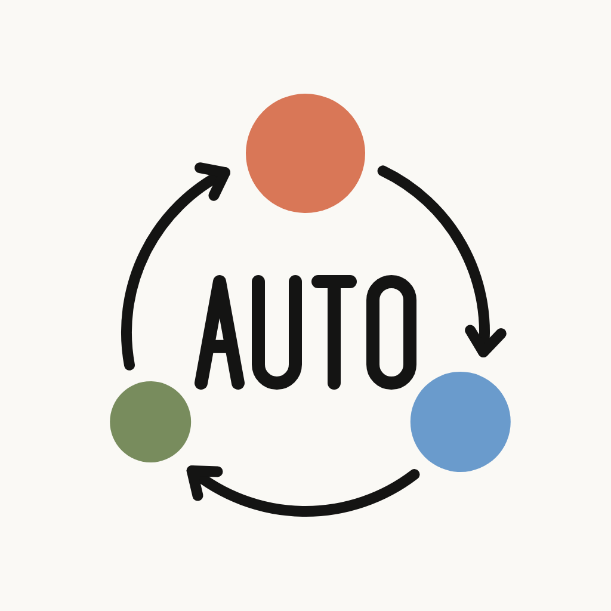

# auto-model



A Claude Code mod that picks the model for each turn from the complexity of your prompt.

When it is on, a cheap call to the small fast model rates each prompt as simple, moderate or complex. Every request in that turn then runs on the matching model:

| Complexity | Model |
|---|---|
| simple | haiku |
| moderate | sonnet |
| complex | opus |

Prompts shorter than 6 words (for example "yes, do it") keep the previous turn's model, so a short follow-up inside a hard task does not drop to the smallest model. Subagents keep the session's model. If the rating call fails, a word-count rule is used instead.

## Install

```
/plugin install auto-model --marketplace NeoNeuron/auto-model
```

Answer `y` to add the marketplace, then pick a scope.

## Use

A button sits at the bottom-right of the footer under the prompt box, in the color of the model last picked (`◆ opus ▾`), or dim `◇ auto off ▾`. Click it to open a small panel above the prompt, right-aligned:

```
 auto model  ● on  ×
 ■■■ opus    complex
 ■■■ sonnet  moderate
 ■■■ haiku   simple
```

Each model has its own color (opus orange, sonnet blue, haiku green) and a bar of 3, 2 or 1 filled cells. The row for the model used on the last prompt is bold and the others dim. Click `● on` / `○ off` to switch the mod, and `×` to close the panel. On a narrow terminal the bars and tier words are dropped. The setting is remembered across sessions and defaults to on.

You can also run `/auto-model on`, `/auto-model off`, or `/auto-model` to flip it.

Note: the switch is made per request, so `/model` and the status line keep showing your session model; the button shows the one actually used.

## Cost: what auto-model adds, and what a model switch costs

**Short answer:** switching models does not reload your conversation every time. The API is stateless, so every request already resends the whole context. What changes is the *prompt cache*, which is kept per model. The first time a model sees your long context (or after its cache has expired) that context is billed as a cache write. After that each model keeps its own warm copy, and going back and forth between two models costs only the new messages, not the whole context again.

### 1. The classifier call (the mod's own overhead)

For each prompt the mod makes one small call to the engine's small fast model (`$.model.classify`, assumed Haiku-class): about 120 tokens of instructions, plus your prompt cut to 4,000 characters, and a one-word answer. No history and no tools are sent.

- A typical prompt costs about **$0.00003**; the worst case (a 4,000-character prompt) about **$0.00015**. That is roughly $0.03 to $0.15 per 1,000 prompts.
- It adds a short wait before the turn starts.
- It is skipped for prompts under 6 words (they reuse the last tier), for subagents, for empty turns, and while the mod is off. If the call fails, a word-count rule picks the tier instead.

### 2. What a switch costs

Cache prices per million input tokens (list prices; a cache read is 0.05x to 0.1x of the input price, a 5-minute cache write 1.25x):

| Model | Input | Cache read | Cache write (5 min) |
|---|---|---|---|
| Opus 5.5 | $4.00 | $0.20 | $5.00 |
| Sonnet 5.5 | $2.00 | $0.10 | $2.50 |
| Haiku 5.5 | $0.10 | ~$0.01* | ~$0.125* |

\*Haiku 5.5's cache rates are taken as the general 0.1x / 1.25x multipliers. Haiku counts about 30% more tokens for the same text, and its prices step up for prompts over 100K tokens.

Input-side cost of one request, by context size:

| Context | Opus, cache warm | Sonnet, cache warm | Switch to Opus, cold | Switch to Sonnet, cold | Switch to Haiku, cold |
|---|---|---|---|---|---|
| 50K tokens | $0.010 | $0.005 | $0.25 | $0.125 | ~$0.006 |
| 100K tokens | $0.020 | $0.010 | $0.50 | $0.25 | ~$0.013 |

So a switch is only expensive when it goes **to a bigger model whose cache is cold, on a long conversation**. Going down to Haiku is cheap even cold, because its write price is below Opus's read price.

### 3. Switching back and forth

Each model has its own cache entry for the part of the conversation it has already seen, and each read keeps that entry alive. Alternating Opus, Sonnet, Opus, Sonnet therefore costs one cold write per model, once. After that each switch pays a cache read for the earlier context plus a write for the messages added since that model last ran, not a full reload. Over a long session each new message is written once per model that sees it, instead of once in total.

When it does cost more:

- **A model's cache expired.** The default time to live is 5 minutes (1 hour on the extended setting). After a longer pause, the next request on any model pays a cold write, with or without this mod.
- **A very long tool loop.** A cache lookup walks back at most 20 positions, so a long run of sequential tool calls can miss the earlier entry and rewrite the context.
- **A one-off prompt on a long context.** A cold switch to Sonnet at 100K tokens costs about $0.23 more than staying on warm Opus. Sonnet's cheaper reads and half-price output pay that back in roughly 8 turns (assuming about 2K output tokens a turn), so a single simple prompt late in a long session may cost slightly more than it saves.

The wait before the first token is also longer on a cold switch, since the model has to process the whole context once.

### 4. How the mod limits switching

- Prompts under 6 words keep the previous tier, so "yes, do it" does not flip the model.
- Subagents are never switched.
- One toggle (or `/auto-model off`) puts everything back on your session model.

### How these numbers were made

They are worked out from list prices and the documented cache rules (model-scoped caches, 5-minute and 1-hour lifetimes, the 20-position lookback), not measured in a live session. To check your own, compare `cache_creation_input_tokens` and `cache_read_input_tokens` around a switch in your usage reports: a cold switch shows a large write once, and a return within the lifetime shows mostly reads.

## License

MIT © 2026 Kai Chen
